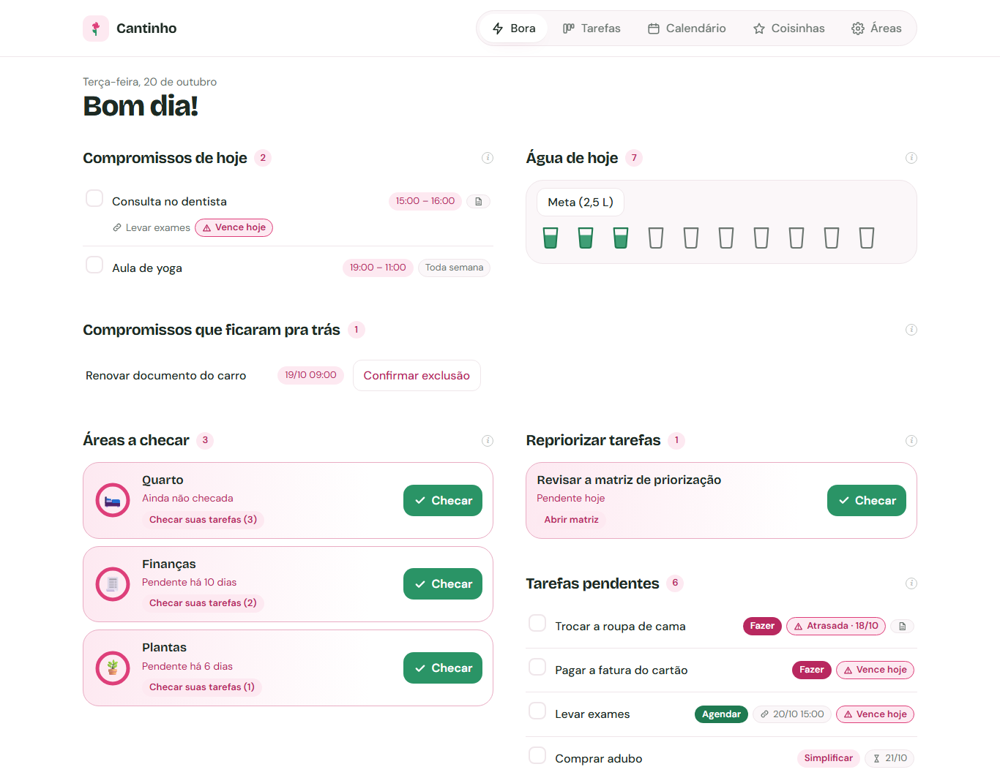
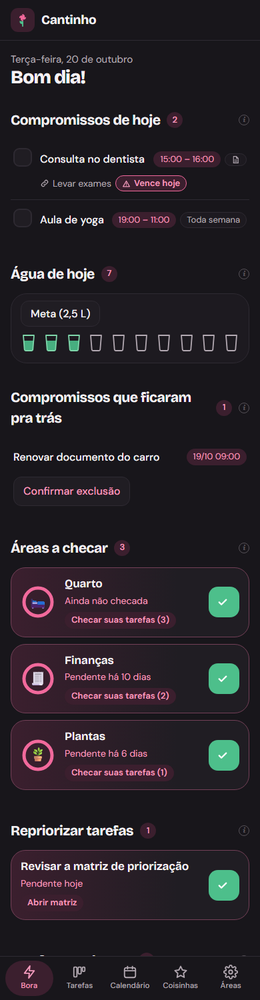
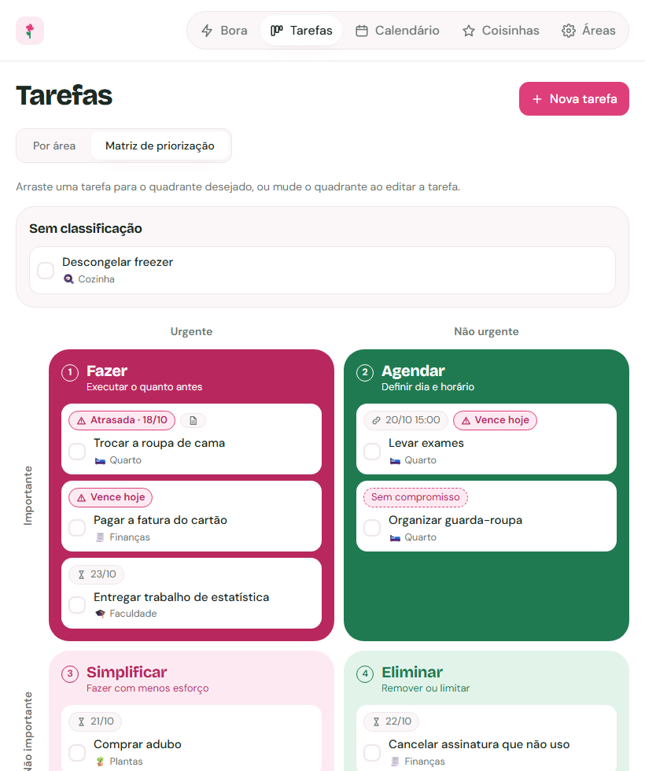

# Cantinho

**Um organizador pessoal que responde a uma pergunta só: "o que eu preciso fazer agora?"**

Cantinho junta num lugar tudo que pede atenção na vida de uma pessoa (casa, finanças, estudos,
saúde, compromissos) e, todo dia, mostra apenas o que exige ação. Projeto completo, do banco de
dados à interface, feito para uso real.

**[Abrir o site](https://cantinho.coutinhoucarol.workers.dev)** · clique em **Criar conta** e, dentro do app, em **Usar exemplos** para vê-lo preenchido.



## A ideia

Ferramentas de organização costumam virar um depósito: anotações, listas e lembretes que ninguém
revisita. O Cantinho parte do contrário:

> **Nada no sistema pode existir solto.** Tudo que é cadastrado precisa ser conferido de tempos em
> tempos e levar a uma ação. Para isso existe a aba **Bora**.

A Bora é a tela do dia. Ela reúne, num só lugar, o que venceu, o que acontece hoje e o que ficou
pendente. Se a Bora está vazia, a pessoa pode ficar tranquila de que não esqueceu nada. Essa
promessa guiou todas as decisões do produto.

## Como funciona

| Aba | Para que serve |
| --- | --- |
| **Bora** | A tela do dia: compromissos de hoje, água, áreas a checar, repriorização das tarefas, tarefas pendentes e o que precisa ser organizado. |
| **Tarefas** | Por área da vida ou na **matriz de priorização** (Fazer, Agendar, Simplificar, Eliminar), com arrastar e soltar. |
| **Calendário** | Visão de mês e de semana, com compromissos únicos ou que se repetem. Tarefas podem ser ligadas a um compromisso. |
| **Áreas** | Partes da rotina que pedem atenção periódica: "limpeza da casa a cada 3 dias", "finanças a cada 30 dias", "estudar toda sexta às 7h". Quando o prazo vence, a área aparece na Bora para ser checada. |
| **Coisinhas** | Listas leves: indicações (filmes, séries, livros) e hobbies para testar. |

<p>
  
  &nbsp;&nbsp;
  
</p>

## Decisões de produto que sustentam a promessa

Antes de mexer no código, mapeei o sistema inteiro para achar tudo que podia ficar "solto" (fora da
Bora). Cada lacuna virou uma regra:

- **Prazo vencido não passa despercebido.** Tarefa atrasada ou com prazo hoje ganha o mesmo alerta
  em todas as telas. Tarefa com prazo até depois de amanhã sobe para as pendentes, em qualquer
  quadrante.
- **Nada some em silêncio.** Um compromisso que passou sem ser marcado como feito não é apagado:
  fica na Bora até a pessoa confirmar a exclusão. Vale também para cada dia perdido de um
  compromisso que se repete.
- **Revisão diária obrigatória.** Repriorizar as tarefas na matriz é uma pendência que volta todo
  dia na Bora.
- **A mensagem "Tudo certo por hoje" é honesta.** Só aparece quando compromissos, áreas, tarefas,
  revisões e água estão em dia.
- **O que está pendente continua pendente.** A Bora é calculada a partir da data de hoje: ficar
  dias sem abrir o app não perde nada, e a área mostra "pendente há 6 dias".
- **Consistência de interface.** Revisei botões e textos para que a mesma ação tenha o mesmo nome e o
  mesmo visual em todo o app, e removi informações que nenhuma tela usava.

## Como foi construído

| Camada | Tecnologia |
| --- | --- |
| Interface | React 19, TypeScript, Vite, Tailwind CSS 4 |
| API | Cloudflare Worker (Hono + TypeScript), no mesmo endereço do site |
| Banco | PostgreSQL (Supabase), via Hyperdrive da Cloudflare |
| Testes | Vitest e Testing Library (interface), Vitest contra um Postgres real (API) |

Pontos que valem destaque:

- **Funciona mesmo com o servidor fora do ar.** Os dados são gravados no aparelho na hora e
  sincronizados com a conta em seguida; se a API falha, o app segue funcionando e avisa o motivo.
  Limites dos planos gratuitos (cota, banco pausado, teto de contas) têm mensagens claras em vez de
  tela em branco.
- **Segurança.** Senha com PBKDF2-SHA256 e sal; sessão em cookie `httpOnly`; cada linha do banco
  pertence a um usuário; Row Level Security ligado para a API pública do banco não enxergar nada.
- **Testes de verdade.** Cerca de 160 testes automáticos. Os da API rodam num schema temporário do
  Postgres real, sem tocar nos dados.
- **Responsivo e acessível.** Usado em celular, tablet e computador, com modo claro e escuro (conferi
  as telas nos três tamanhos e nos dois modos). Botões com nomes para leitores de tela, caixas de
  diálogo nativas e reordenação de áreas também pelo teclado.
- **Instalável no celular.** Ícone próprio e manifesto para adicionar à tela inicial.
- **Banco versionado.** Mudanças no banco por migrações SQL numeradas.

## O que este projeto demonstra

- **Visão de produto:** partir de um problema real, definir um princípio claro ("nada solto") e
  traduzi-lo em regras testáveis.
- **Desenvolvimento ponta a ponta:** modelagem de dados, API, autenticação, interface e publicação.
- **Atenção à qualidade:** testes automatizados, auditoria de consistência da interface e revisão
  visual em vários tamanhos de tela.

## Rodar no seu computador

Instruções de instalação, testes, publicação e o modelo de dados estão em
[docs/DESENVOLVIMENTO.md](docs/DESENVOLVIMENTO.md).

```
cantinho/
├── frontend/   # interface em React
├── worker/     # API (Cloudflare Worker), migrações do banco e testes
└── docs/       # guia de desenvolvimento e imagens
```

## Próximos passos

- Notificações no celular. Hoje a Bora só mostra o que está pendente quando o app é aberto.
- Mostrar na Bora os compromissos dos próximos dias, não só os de hoje.
- Histórico do que foi concluído.
